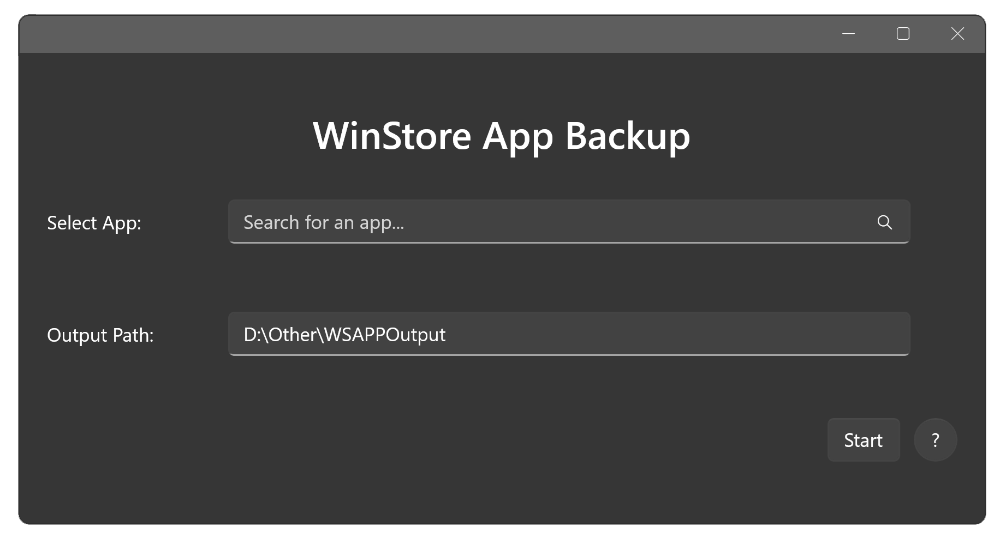

# 📱 WSAppBak: Windows App Backuper

[](https://docs.microsoft.com/en-us/windows/apps/winui/winui3/)
[](https://docs.microsoft.com/en-us/dotnet/csharp/)

WSAPPBak is a powerful and user-friendly WinUI 3 Windows application designed to Backup Windows Application. And Backup Application along with Certificates.



## 🚀 Key Features

- 😈 **Paid Apps**: Install Paid Apps for Free
- 📊 **Backup**: Backup applications alongside Certificates
- 🎨 **Modern UI**: Sleek and intuitive interface built with WinUI 3
- 🔄 **Easy to Use**: Easily Get your app with a single click
- ⚡ **Fast Performance**: Optimized for speed and low resource usage

## 🏁 Getting Started

### Prerequisites

- Windows 10 (Recommended: Windows 11)
- .NET 5.0 Runtime or later
- At least 200MB of free disk space

### Installation

1. Download the latest release from [GitHub Releases](https://github.com/MadCkull/WSAppBak/releases) page.
2. Install Dependencies and package Certificates (See [Closed Issues](https://github.com/MadCkull/WSAppBak/issues?q=is%3Aissue+is%3Aclosed) Section for details)
3. Install Application
4. Done.
### or
1. Clone Repo
2. Open solution in Visual Studio
3. Build & Run.

### Building and checking the portable ZIP

Use Visual Studio MSBuild with the .NET SDK and Windows/WinUI build tools installed:

```powershell
./scripts/Build-Portable.ps1 -Version dev -SmokeTest
```

The script builds an x64 app with both runtimes included, uses separate portable
intermediates, and validates a freshly extracted ZIP before saving it under
`artifacts/portable/`. Use a new version label or output folder for each build.
The smoke test opens a window briefly and requires a Windows desktop session.

To check an already extracted download:

```powershell
./scripts/Test-Portable.ps1 -Path 'C:\path\to\extracted-app' -Launch
```

Keep the entire extracted folder together, including `WSAppBak.pri`. The v2.0.0
portable release omitted that generated resource index, causing a startup crash
before the window appeared (issues #15 and #16). Replacing framework DLLs or
installing extra runtimes does not supply the missing application resources.


### Building the MSIX installer

On Windows with Visual Studio's .NET and Windows packaging tools installed:

```powershell
./scripts/Build-MSIX.ps1
```

This restores dependencies, builds an unsigned x64/ARM64 bundle, and checks its
resources, native architectures, included .NET runtimes, and dependency packages.
Outputs are in a fresh directory under `artifacts/msix/`. Unsigned bundles are
for build validation; installation requires signing.

For a signed build, set `WSAPPBAK_CERTIFICATE_PASSWORD` in your local environment
and pass `-CertificatePath 'C:\path\to\signing.pfx'`. Keep the PFX and password
out of Git. The release workflow uses GitHub secrets and includes the public
signing certificate, `Install.ps1`, and the `Dependencies` directory in its ZIP.
After trusting the certificate, run `Install.ps1` as the intended Windows user
to install the matching dependencies and application together.

To prepare a release, run the **Prepare WSAppBak release** GitHub Actions workflow
with the matching version (for example `v2.0.1`). It verifies the application and
MSIX versions, builds both distributions, and saves a draft release with release
notes and SHA-256 checksums. Publishing that draft is a separate step.

See [MSIX validation notes](docs/msix-validation.md) for the reproduced failures,
test results, and remaining platform checks.

## 📘 Usage Guide

1. Launch WSAPPBak from your Start menu or desktop shortcut.
2. Select the Application You want to Backup from the dropdown menu.(Instructions are provided in Help Window)
3. Choose a destination.
4. Click "Start" and wait for the process to complete.

### To Install App:

1. Open Output Folder.
2. Install Certificates (Detailed Instruction are given in Help Window)
3. Install Appx File.
4. Enjoy Paid App for Free. 😈

## 🔧 Troubleshooting

Encountering issues? Try these steps:

1. Ensure you're running the latest version of **WSAPPBak** and **Windows 11**.
2. Having issues in installation? Check [Issues](https://github.com/MadCkull/WSAppBak/issues?q=is%3Aissue+is%3Aclosed) Section.
3. If the problem persists, please [open an issue](https://github.com/MadCkull/WSAppBak/issues) on our GitHub page.

## 🤝 Contributing

We welcome contributions! Here's how you can help:

1. Fork the repository
2. Create your feature branch (`git checkout -b feature/AmazingFeature`)
3. Commit your changes (`git commit -m 'Add some AmazingFeature'`)
4. Push to the branch (`git push origin feature/AmazingFeature`)
5. Open a Pull Request

## ⚠️ Disclaimer

  It's crucial to understand that circumventing paid app licensing is illegal and unethical. This repository is intended for educational purposes only. Distributing or using WSAppBak to install paid apps for free violates copyright laws and developer rights.

## 👏 Acknowledgments

- Thanks to [Wapitiii](https://github.com/Wapitiii/WSAppBak.git) (Original Repo)
- Special thanks to the WinUI 3 team for their excellent framework
- Icon assets provided by [Iconify](https://iconify.design/)


## Note:

It's not 100% accurate, don't expect it to work on every app..

---

Made with 😈 intentions by **MadCkull**
